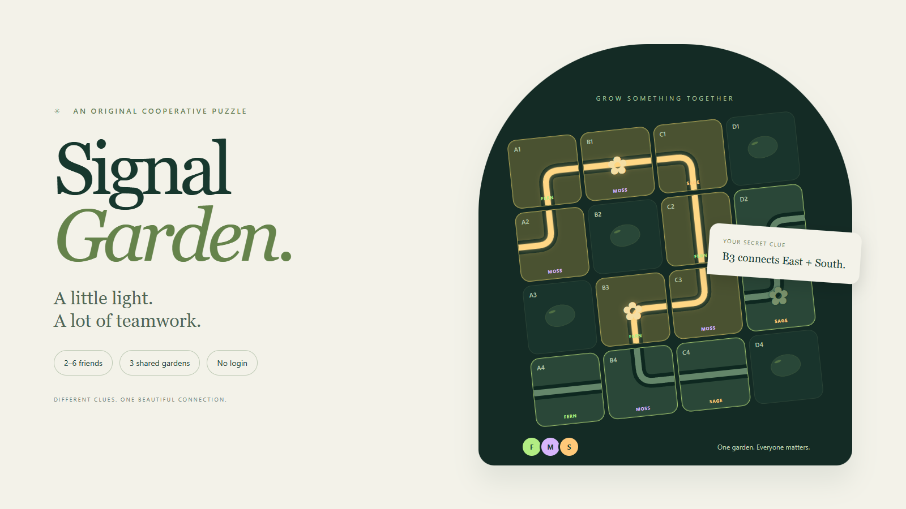

# Signal Garden

**[Play Signal Garden](https://signal-garden.signal-garden.workers.dev/)**

## Contest project

Created by Cristian with ChatGPT for the **Handshake AI Skills Studio × OpenAI “Create a Multiplayer Game” challenge**.

The project brief: build a multiplayer game that friends, family, or classmates can join from their own phones or laptops, using a room code with no login or installation. This project explored that brief with a **one-hour prototype goal**, followed by testing, polish, and public deployment. The one-hour goal describes the intended build exercise, not a verified total completion time or a claim about the contest's official rules.

ChatGPT assisted with brainstorming, game design, implementation, debugging, and documentation. This repository documents an independent participant project; it does not claim official endorsement, selection, or a prize.

## The game

An original cooperative light-routing puzzle for 2–6 people. Each person controls a subset of the shared board and receives clues about someone else's tiles. Together, the group connects sunlight to three flowers and the exit across three procedurally generated gardens.

## Run locally

Requires Node.js 22.13+ (the development build used Node.js 24.19). No runtime npm dependencies.

    npm start

Open http://localhost:4317. The local server binds to the loopback interface and uses an in-memory SQLite database; local rooms disappear when it restarts. It is for local testing, not a public deployment.

    npm test
    npm run build

The build contains `dist/client`, `dist/server/index.js`, and `dist/.openai/hosting.json`. The Worker is self-contained and expects the `ASSETS` binding and a Cloudflare D1-compatible database bound as `DB`.

## Public hosting

LIVE: https://signal-garden.signal-garden.workers.dev

The live game runs on Cloudflare Workers with static assets and a D1 database. GitHub hosts this source code; the multiplayer server runs on Cloudflare. Publishing changes to this repository alone does not update the live deployment.

### Deploy your own copy

1. Create a Cloudflare account and authenticate Wrangler with `npx wrangler login`.
2. Copy `wrangler.example.json` to `wrangler.json` and choose your own Worker name.
3. Run `npx wrangler d1 create signal-garden-db`. Put the returned database ID and your chosen database name in `wrangler.json`.
4. Initialize the database with `npx wrangler d1 execute signal-garden-db --remote --file=schema.sql`.
5. Run `npm run build`, then `npx wrangler deploy`.
6. For your fork, change the canonical URL and sharing-image URL in `public/index.html` to your deployment's URL, then build and deploy again.

The Worker expects the database binding `DB` and asset binding `ASSETS`. Normal updates reuse the existing database. Free-plan quotas apply. Account-specific configuration, authentication files, and environment secrets are excluded from the public package.

The optional `.openai/hosting.json` is a portability manifest with no Sites project ID. ChatGPT Sites was unavailable in the original workspace, so this deployment uses Cloudflare directly.

## How the multiplayer system works

- A six-letter code identifies a room. Each player receives an opaque random session token; only its SHA-256 hash is stored on the server.
- The authoritative room document is held in D1. Updates compare the previous version and retry conflicts, preventing simultaneous turns from overwriting each other.
- Screens poll every 750 ms while visible, and every 4 seconds in the background. This is synchronized near-real-time play, not WebSocket push.
- A move includes an action ID for retry deduplication and the current round to reject delayed moves from an earlier garden.
- The API strips tokens, target rotations, and other private state from responses. Each player only receives their assigned clue cards.
- Tile ownership is checked on the server. After 25 seconds without a heartbeat, a disconnected player's tiles become available to the remaining players. The first active player becomes the room guide.
- The same tab can reconnect using sessionStorage. Closing the tab can lose that session. The UI pauses moves when synchronization becomes stale.
- Rooms become inaccessible after 24 hours; expired records are removed during later room creation. Request rate counters are also cleaned at room creation. The nickname and fixed messages are the only player-supplied content shown to other players.
- Public route mutation checks reject mismatching Origin headers. Input is validated, names are rendered as text, and API responses are not cacheable.

## Game design

- Audience: friends, families with teens, and classmates aged 13+.
- No accounts, installs, open chat, payment, or runtime AI calls.
- Three 4-by-4 gardens. Every generated path is solvable; randomness changes the route and initial rotations.
- Each tile is a straight channel, elbow channel, or stone. Clicking an available channel rotates it clockwise; clicking another player's tile pings it.
- Clues specify compass directions at named cells (A1–D4). Players share clues aloud or on an existing voice call.
- The shared route glows gold, flowers bloom, and all players share the same score.
- No timer penalty. Three stars: at most 36 turns and no hints; two stars: at most 60 turns; otherwise one star. Hints cap a garden at two stars.
- Includes keyboard-operable controls, named tile buttons, reduced-motion support, an optional sound cue, a help dialog, reconnect status, and solo practice.

## Tests

`npm test` runs the pure game-rule suite, including 500 randomized puzzle solutions. Browser checks use Playwright and an installed Microsoft Edge browser. To run them on another machine, install Playwright locally and set a supported channel in the scripts if Edge is unavailable. `PLAYWRIGHT_MODULE` may be set to an absolute file URL for an existing installation.

    node scripts/e2e.mjs
    node scripts/reliability.mjs

Set `GAME_URL` to the published HTTPS origin to repeat the browser/API tests against hosting. These tests create disposable rooms. `scripts/cover.mjs` creates the original 1600×900 cover from the game's own vector artwork. `scripts/screens.mjs` captures desktop and mobile layouts.

The game-rule suite, production multiplayer browser checks, and reconnect/reliability checks passed on October 3, 2026. Browser checks used separate desktop and mobile-sized contexts; this is not a load-test result.

## Source map

- public/index.html: entry page, rules, and privacy explanation
- public/app.js: player UI and synchronization
- public/style.css: responsive visual design
- public/cover.png: project cover
- src/game.mjs: pure rules, generation, permissions, and private views
- src/worker.mjs: HTTP API and persistent state
- scripts/build.mjs: self-contained Sites Worker and client packaging
- scripts/local.mjs: local HTTP and SQLite test adapter
- tests/game.test.mjs: game-rule tests

All interface artwork is original CSS/SVG or browser-rendered artwork created for this project. System fonts are used; there are no remotely loaded fonts or third-party media assets.
